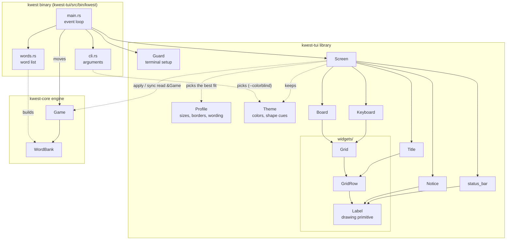
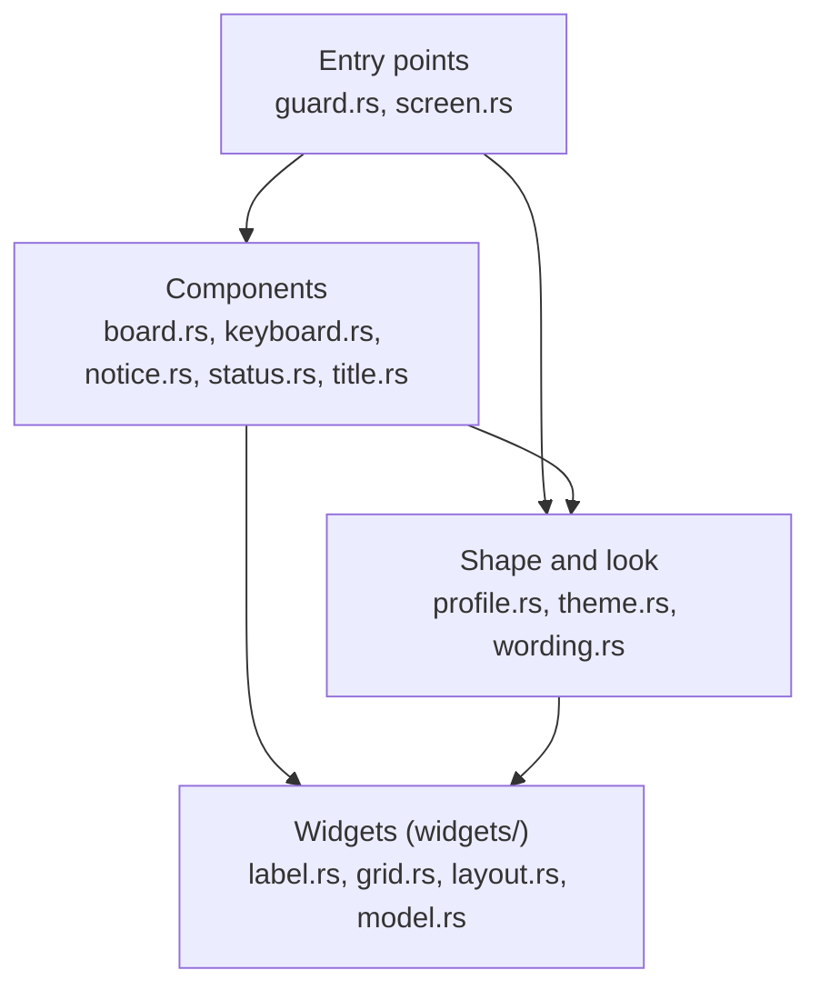
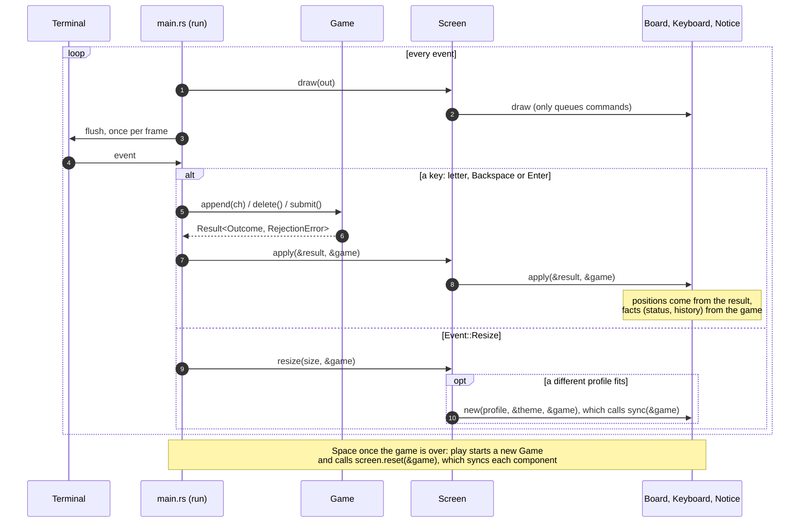

# Architecture

How Kwest is put together, and why. For playing, see the [README](README.md); for the rules a
change has to meet, see the Conventions in [`CLAUDE.md`](CLAUDE.md).

Kwest is a UI-agnostic game engine plus a hand-rolled terminal frontend built directly on
`crossterm`. There is no ratatui or other TUI framework, on purpose: the frontend is small enough
that its own layout code stays simple, and it is a learning project.

## Overview

Solid arrows are ownership (each box holds the ones below it); dotted arrows are uses. Every
component is also built from two values passed in: a `Profile`, its shape, and a `Theme`, its look.
The diagram shows only where each comes from; the arrows to every component are left out to keep
the picture readable. The engine knows nothing of the frontend: every arrow into `kwest-core`
points one way.



## Workspace layout

```
Cargo.toml                    workspace: shared package metadata, lints, and dependency versions
kwest-core/                   game engine (lib)
kwest-tui/                    terminal frontend
kwest-tui/src/                library: screen, components, profiles and theme; lib.rs exports
                              only what the binary needs
kwest-tui/src/widgets.rs      the widgets module: re-exports the files in widgets/ to the rest
                              of the crate (the Rust 2018 layout, with no mod.rs)
kwest-tui/src/widgets/        labels, grids, layouts and their model types, with no game
                              knowledge
kwest-tui/src/bin/kwest/      the `kwest` binary: main.rs, cli.rs, words.rs. Cargo finds it by
                              this path and names it after the folder, so there is no [[bin]]
kwest-tui/data/words.txt      word list (one word per line, 2114 five-letter words), embedded
                              in the binary with `include_str!`
kwest-tui/data/build_words.py generates words.txt from SCOWL; see data/README.md
```

Word lists live inside the crate that embeds them, because `include_str!` paths that reach outside
the crate directory break `cargo package`.

`words.txt` is generated, not hand-edited: common SCOWL words, without inflected forms and minus a
hand-picked exclusion list. To change it, edit `build_words.py` (usually `EXCLUDED`) and regenerate;
CI checks that the two agree. See [`kwest-tui/data/README.md`](kwest-tui/data/README.md).

## kwest-core: the engine

The engine holds the rules and the game state and knows nothing about how they are shown. Public
API (`kwest-core/src/lib.rs`):

- `WordBank`: sorted, deduplicated, non-empty, canonical (uppercase ASCII) word list of a fixed
  length. Built with `from_words` / `from_reader`, which take the length as a `NonZeroUsize`.
  Provides `contains`, `random_word(&mut Rng)`, and `word_length`.
- `Game::new(max_attempts: NonZeroUsize, Arc<WordBank>, &mut Rng)`. Counts that can't be zero are
  `NonZeroUsize` in the API, so zero doesn't compile (a doctest checks it) rather than being
  checked at run time; getters return plain `usize`. Moves: `append(ch)`, `delete()`, `submit()`,
  each returning `Result<Outcome, RejectionError>`. Queries: `evaluated_guesses()`,
  `active_guess()`, `history(ch) -> LetterHistory`, `status()`, `pending_attempts()`,
  `max_attempts()`, `word_length()`, `is_over()`, `refusal()`.
- `refusal() -> Option<&RejectionError>`: why the last `submit` was refused, kept until the guess
  changes. A successful `append` or `delete` clears it; a refused one leaves it, since the guess is
  unchanged. It is the one thing a refused move changes. It lets a frontend rebuild its view from
  the game alone (the TUI's red row and "Not in word list" survive a profile switch).
- `Outcome`: `Appended { ch, attempt, index }`, `Deleted { ch, attempt, index }`,
  `Submitted { attempt, guess }`. Each says where the change happened: `attempt` is which guess
  (the board row) and `index` the position in it (the column), both from 0. The UI updates just
  that place, without working positions out from the game.
- `RejectionError`: `GameOver`, `InvalidCharacter`, `LengthExceededMaximum`, `EmptyGuess`,
  `IncompleteGuess { letters, word_length, attempt }`, `NotInWordBank { word, attempt }`. Only
  `Game` raises them, and the variants that refuse a whole guess carry `attempt`, its board row.
  Their `Display` text is for developers (logs, other frontends); the TUI words its own messages.
- `Tag`: `Absent < Present < Correct`. **Variant order matters.** `LetterHistory.tags` is a
  `BTreeSet<Tag>`, so `tags.last()` is the best tag a letter has achieved, which is what the
  keyboard should show.
- `Status`: `InProgress`, `Won`, `Lost { secret }`.

Evaluation (`eval.rs`) handles duplicate letters the Wordle way: exact matches first, then
`Present` is assigned left to right against the remaining unmatched counts. It is infallible:
`Game` refuses an incomplete guess before scoring, so equal lengths are a precondition (checked
by a `debug_assert!`), not an error.

## kwest-tui: the terminal frontend

### Screen

`Screen` stacks five components, top to bottom:

| # | Component  | Built from | Shows |
|---|------------|------------|-------|
| 1 | Title      | `Title` wrapping a `GridRow`, one underlined cell per letter | "KWEST" heading, as wide as a board row |
| 2 | Board      | `Board` wrapping a `Grid` | Evaluated guesses styled by `Tag`, the active guess, and empty remaining rows |
| 3 | Notice bar | `Notice` wrapping one fixed-size `Label` | Rejected-guess messages, win/loss (reveals the secret on loss) |
| 4 | Keyboard   | `Keyboard` wrapping a ragged QWERTY `Grid` (key size from the profile) | Each letter styled by its best tag from `Game::history(ch)`; untried letters stay neutral |
| 5 | Status bar | plain `Label` from `status_bar(width, wording, &theme)` | Key hints only |

### Modules

The modules come in four layers, each using only those below it, and `lib.rs` declares them in
that order. To read the code, start with `Screen`, then one component (`Board` is the fullest), then
`Label`, the one drawing primitive. `errors.rs` holds the library's two error types and is used by
every layer.



#### Entry points

- `Guard` (`guard.rs`): RAII terminal setup and restore (raw mode, alternate screen, hidden
  cursor), plus a panic hook that restores the terminal. Hold it for the whole session. The hook
  is process-wide, so it is installed once (`Once`) and acts only while a guard is alive (an
  `AtomicBool`). That flag also makes `enter` refuse a second guard with
  `GuardError::AlreadyActive`; a terminal failure is `GuardError::Terminal`.
- `Screen` (`screen.rs`): owns the five components, built with one profile and the theme, as a
  private `Components` struct with named fields, and stacks them in a terminal-sized `ColumnLayout`.
  It uses the **least cluttered profile that fits** the terminal.
  - `new(&game, terminal_size, &theme)` asks every profile for its `required_size` once (game
    dimensions are fixed for the session), then builds the components of the best one. It keeps
    the theme, so a profile switch rebuilds them in the same look.
  - `required_size()` is the active profile's; when none fits, the active profile is the most
    compact, so the banner asks for its size. `fits()` tells whether the terminal is big enough.
  - `reset(&game)` prepares a new game **in place**: it calls `sync` on the board, keyboard and
    notice. Nothing is rebuilt, sizes and layout are kept, and it can't fail.
  - `resize(size, &game)` picks the best profile again. If it changed, in either direction, the
    components are **rebuilt from the game** (`new` → `sync`), so play carries on where it was;
    otherwise only the layout is recomputed. It changes nothing if it fails.
  - `apply(&result, &game)` passes the update to each component.
  - `draw(w)` draws everything. If the terminal is too small, it draws a full-terminal banner
    instead: "Terminal too small: need WxH, have WxH · Enlarge it, or press Esc to quit". This is
    the **only** too-small handling, both at startup and mid-game. There is no early exit, so the
    player can enlarge the terminal and carry on. The banner says how to quit, because the status
    bar is hidden too.

#### Components

- `Board` (`board.rs`): the guess board wrapping a `Grid` of `max_attempts × word_length` cells.
  Every cell keeps the border sides its profile gave it (all four, or only the left in compact), and
  state changes only change colors and attributes. The active row is highlighted, and
  `NotInWordBank` turns its borders red until the next edit. Evaluated cells show their tag through
  the **letter only**: its color, and with `Theme::COLORBLIND` an underline for Correct. Their
  borders go back to the default color; tag-colored borders looked too loud. Those three border
  states (default, active, invalid) are the only ones the board uses.
- `Title` (`title.rs`): one cell per title letter in a `GridRow`, sized by the profile (7×2 or
  5×2). Cells have a **bottom border only**, an underline in the theme's border color, so the
  title doesn't look like another row of guesses. Cells are as wide and spaced as the board's, so
  it lines up with the board. The letters are in the theme's title color.
- `Keyboard` (`keyboard.rs`): wraps a ragged `Grid` built from a layout passed in (`QWERTY` constant
  in `profile.rs`, one string per row). It is display-only. On `Submitted`, each guessed letter's
  key takes the style of its best tag, `game.history(ch).tags.last()`, like default Wordle: its
  color. Untried keys stay neutral. Every key is bold except Absent ones, so ruled-out letters
  recede. With `Theme::COLORBLIND`, a Correct key is also underlined, and Present and Correct keys
  get heavy borders. Key borders otherwise stay in the default color. Keys are found through a
  letter → (row, column) map built once in `new`, which is all the keyboard keeps of the layout.
  Layouts are expected to list each letter once.
- `Notice` (`notice.rs`): one row with no border, as wide as the keyboard. `apply` maps results to
  our own wording, not `RejectionError`'s developer-facing `Display` text (the end-of-game texts
  come from the profile's `Wording`; the full ones are shown here):
  - `NotInWordBank` → "Not in word list" and `IncompleteGuess` → "Not enough letters", both in
    the theme's error color.
  - A win → "Solved in n/max! Press Space for a new game" in its won color.
  - A loss → "The word was X. Press Space for a new game" in its lost color.
  - Appending or deleting clears the message. Minor rejections (empty guess, full guess,
    non-letter key) are **silent** and leave the message as it is.
- `status_bar(width, wording, &theme)` (`status.rs`): a plain dim `Label` of key hints. It never
  changes, so it isn't its own component, but it lives in the library so its color comes from the
  theme.

#### Shape and look

- `Theme` (`theme.rs`): **the look**, a `Copy` struct like `Profile`: every color, and `shape_cues`.
  `Theme::STANDARD` shows tags by color only; `Theme::COLORBLIND` is the same with shape cues on
  (struct update syntax, so they differ in one field). The player picks it with `--colorblind`, and
  it is the same in every profile. It is **the only** mapping from game state (`Tag`, active,
  invalid) to colors (`tag_color`), text attributes (`tag_attributes`) and key styles (`key_style`).
  Its fields are `pub(crate)`: outside the crate, a theme can only be one of the constants.
- `Profile` (`profile.rs`): **the structure**, a `Copy` struct of constants: board cell, title cell
  and key sizes, their `Border`s (which sides exist; the color is a placeholder that components
  replace with the theme's), spacing, and a `Wording`. It holds no look. `PROFILES = [FULL,
  COMPACT]`, least cluttered first.
  - `FULL` is 7×3 boxed cells and keys and needs 79×35.
  - `COMPACT` is one row per cell (5×1, with 1 row between board rows) and needs 59×24, so it
    fits 80×24. Board cells and keys both have a left border only (`│ A`): with left and right,
    neighbors drew confusing double bars. So the last cell or key in a row has no closing bar.
    One border side is enough for the border-color states.

  `required_size(&game)` works out the screen size from sizes alone, with the same layouts the
  components use, without building them; a test checks it against a built screen. `TITLE` and
  `QWERTY` live here because it needs them.
- `Wording` (`wording.rs`): the texts that differ by profile, because the text lines are only as
  wide as the keyboard: `won`, `lost` and `hints`. Short error messages fit everywhere and stay
  constants in `notice.rs`.

#### Widgets (`widgets.rs`, `widgets/`)

The building blocks the components are made of. **Nothing in `widgets/` uses `kwest-core`**: the
widgets know nothing of the game, and the components decide what they show. The files are private
modules of `widgets`, and `widgets.rs` re-exports what the rest of the crate uses, so code outside
imports from `crate::widgets` (`use crate::widgets::{Label, Point}`), never from a file in it.

- `Label` (`widgets/label.rs`): the single drawing primitive. It is a box of fixed outer `Size`
  (border included) holding one line of content, centered both ways and truncated by display width,
  with a foreground color, text `Attributes` (bold, underline) and an optional per-side colored
  `Border`. There is no padding: the size decides the spacing. `draw(&mut dyn Write, Point)` writes
  every cell of the box, so drawing over stale content needs no clearing. It only **queues**
  crossterm commands, so the caller flushes once per frame. Tests assert on the exact
  escape-sequence bytes written to a `Vec<u8>`.
- `GridRow` / `Grid` (`widgets/grid.rs`): **pure layout containers** with no game knowledge.
  `GridRow` is labels in a horizontal `FlowLayout`. `Grid` is `GridRow`s in a `ColumnLayout`, so
  rows of different lengths are centered. Each computes its `Geometry` once in `new()` and draws
  children at `origin + locations[i]`. Mutating a label through `label_mut` must not change its
  size.
- Layouts (`widgets/layout.rs`) are pure functions from child `Size`s to a `Geometry` (overall
  size + child-relative `Point`s). They don't draw anything. `Geometry.locations[i]` belongs to the
  i-th size passed in. Widgets are matched to their positions by order, with no widget IDs.
  - `FlowLayout::new(Axis, spacing)`: lays children out in a single row or column. Only
    `Horizontal` is used today; `Vertical` is kept and tested on purpose, under an
    `expect(dead_code)`.
  - `ColumnLayout::new(spacing).with_size(Size)`: a vertical stack, centered horizontally and
    (if given a larger size) vertically. Meant for the top-level screen.
  - Checked arithmetic. Overflow returns `WidgetError::LayoutOverflow`.
- `widgets/model.rs`: `Point` (supports `+`, saturating), `Size`, `Border` (`empty`, `all`, `left`,
  `bottom`, `with_color`, which recolors the existing sides only, and `with_weight`, a
  `LineWeight` of `Light` `┌─┐` or `Heavy` `┏━┓` for all sides), `Geometry`.

### The binary

The binary lives in `src/bin/kwest/`, apart from the library, so another frontend (a GUI is
planned) can sit next to it as its own crate or binary. It is three files, modules of the binary
only (`mod` in `main.rs`), not part of the library's API, which is why their errors aren't in
`errors.rs`:

- `cli.rs`: `kwest [OPTIONS] [WORDS]` with `--colorblind`, `-h`/`--help` and `-V`/`--version`, in
  any order, parsed with the standard library (no `clap`) into a `Command`; bad arguments are an
  `ArgsError`. `--colorblind` picks `Theme::COLORBLIND`, otherwise it is `Theme::STANDARD`.
  `report` prints an error and its causes on one line (`kwest: FILE: failed to read word list: No
  such file…`).
- `words.rs`: `load_bank` builds the bank from the list **embedded with `include_str!`** (so the
  binary runs from any directory), or from the file given, through `WordBank::from_reader`.
  Failures are a `WordListError` (`BuiltIn` or `File`).
- `main.rs`: `main` only dispatches. It returns `ExitCode`, not `Result`, so errors print as
  readable messages; usage errors exit with 2. `play` loads the bank **before** entering the
  `Guard`, so a bad list is reported on the normal screen. `play` creates the first game and the
  `Screen` in the theme from the command line, enters the `Guard`, takes `stdout().lock()` once, and
  runs one game per `run(game, screen, out)`, the event loop, calling `screen.reset()` between
  games. While `!screen.fits()`, only Esc and Ctrl+C are handled, so the player can't change the
  game without seeing the board.

  Keys: letters → `append`, Backspace → `delete`, Enter → `submit`, Esc or Ctrl+C → quit. In raw
  mode Ctrl+C arrives as a key, not a signal, and other keys pressed with Ctrl or Alt held are
  ignored, so they don't type letters. Space starts a new game **only once the game is over**;
  mid-game it falls through to `append` and is silently rejected. On `Event::Resize` it calls
  `screen.resize(size, game)` and clears the terminal.

### A move, end to end

A component's state changes in two ways. During play, `apply` takes the move's result and changes
only the place it names. To build from scratch (a new game, or a profile switch on resize),
`sync` sets everything from the game alone. Drawing is separate from both.



### Design rules for components

- Use concrete types, with no `Component`/`Container` trait. Each component exposes
  `size() -> Size` and `draw(&self, &mut dyn Write, origin: Point)`. Only introduce a trait if the
  duplication actually becomes painful.
- Keep update separate from drawing:
  `apply(&mut self, result: &Result<Outcome, RejectionError>, game: &Game)` changes state, where
  `game` is the state *after* the move. Take positions (row, column, and counts such as the
  notice's "Solved in n", which is `attempt + 1`) from the result only, never partly from `game`,
  so they can't come from two places. Working them out from `game` would copy into the UI how
  each move changes the game's state. Use `game` for facts about the game, such as `is_over()`,
  `status()` or `history()`. Keep game rules out of the UI; they live in `kwest-core`.
- Components with game state (`Board`, `Keyboard`, `Notice`) also have an infallible `sync(&mut
  self, &game)` that sets **all** of it (content, letter color and attributes, border color and
  weight) from the game alone, including `game.refusal()`. It is the second way in, used to build:
  `new(profile, theme, game)` builds the structure and then calls `sync`, a new game is `sync` with
  the new game, and a profile switch builds new components mid-game. During play, updates still go
  through `apply`. Tests check that both ways agree: a component built from a mid-game `Game`
  `assert_eq!`s one played move by move. `Board::sync` uses `debug_assert!` to check that the game's
  dimensions haven't changed.
- Every component is built from `(&Profile, &Theme)`, and those that update later keep a copy of
  the theme. Nothing reads the look from a global, so tests build components in either theme side
  by side.
- Sizes are fixed at construction, so cached geometry never goes stale. Change colors, attributes,
  line weight or content, never add or remove a border side at runtime: labels get their border
  shape once from the profile and later only `update_border_color` and `update_border_weight`.
  Notice and Status keep a fixed width and truncate their text. A different size means a different
  profile, which builds new components.
- Key styles come from `Theme::key_style(best_tag)`, the best tag only, like default Wordle.
  It was a deliberate choice not to signal "another copy still to place": `history()` is a set
  of tags and can't tell that case apart, so it would need per-guess counting.
- Tag colors are Wordle's: green, yellow, and dark grey for Absent. Absent fades rather than
  turning red, so it differs from Correct by brightness. Red is kept for errors: the invalid-word
  border and its notice.
- With `--colorblind` (`Theme::COLORBLIND`), color is never the only cue. Correct letters are
  also **underlined**, on the board and the keyboard, because green and yellow are the pair
  red-green colorblind players confuse; with Absent set apart by brightness, every tag on the
  board can be read without its hue. On the keyboard, Present and Correct keys also get **heavy
  borders**, which set Present keys apart from untried ones. Heavy line characters rather than the
  bold attribute: many terminals draw box lines themselves and ignore bold. The cues are opt-in,
  like Wordle's own setting, because players who don't need them disliked the look. They replaced
  a planned `--high-contrast` palette (orange and blue), which still relies on color and needs a
  256-color terminal. Giving every tag its own style (bold, underline, dim) was tried and looked
  wrong; one marked state is enough.
- Every key is bold except Absent ones, in every theme: bold means the letter may still be in the
  answer, which helps every player. Dark grey alone looked too much like the untried keys' text
  color. Bolding only untried keys made them outshine the green and yellow ones, and bolding Absent
  too made the dark grey lighter. The board is not bold. Bold and underline are widely supported,
  and a terminal without them shows the plain colors.
- Render loop: queue every draw, then flush stdout once, redrawing everything each frame.
  Redrawing only what a move changed is planned, driven by the `Outcome`, not by change
  detection in the components.
- Test components with a real `Game` built on a one-word `WordBank` (a deterministic secret), and
  test drawing by writing into a `Vec<u8>`.

## Planned

- Two word lists, as in real Wordle. `words.txt` will be split into `answers.txt` (about 2.3k
  common words the secret is chosen from) and `guesses.txt` (about 10k extra words accepted as
  guesses). Today one `WordBank` does both jobs, so valid but uncommon words are rejected as "Not
  in word list". This needs a core change, because `Game` takes a single `WordBank`.
